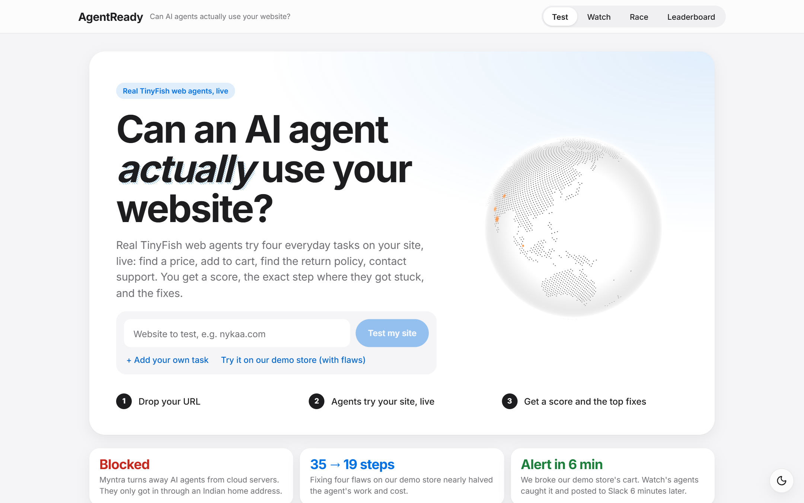
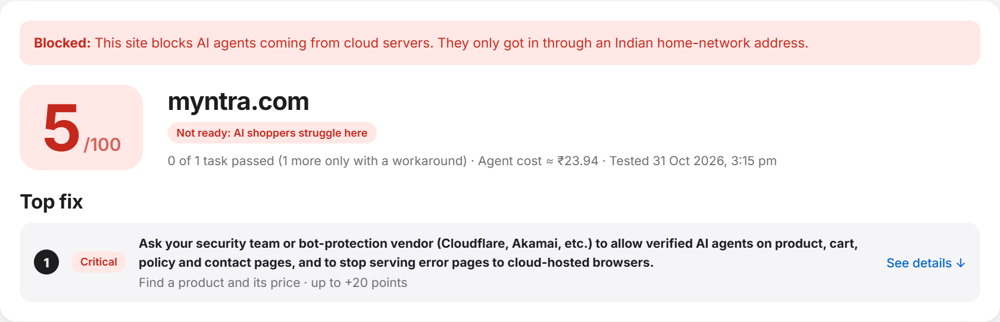
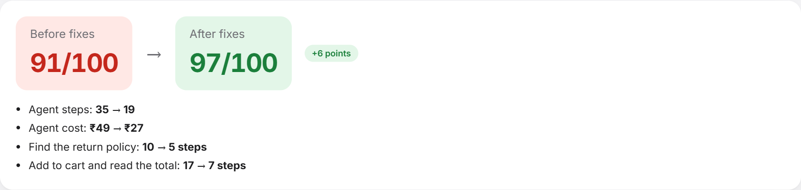
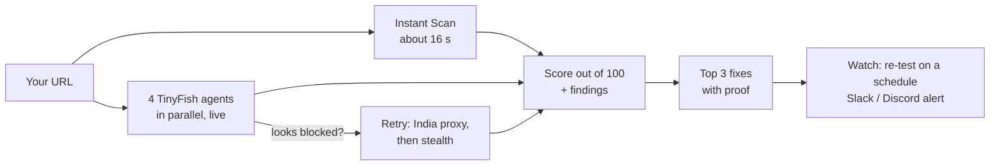
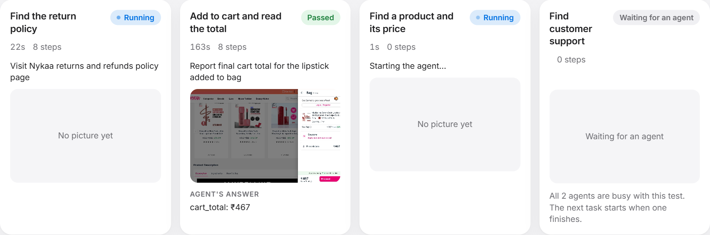
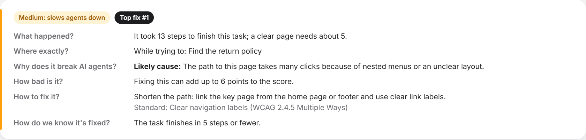
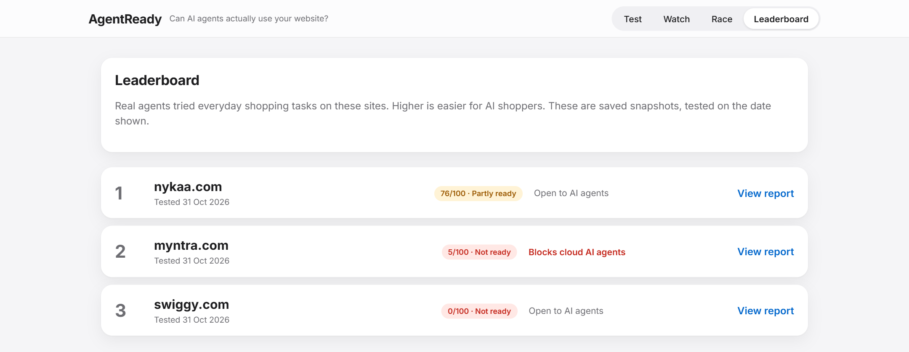

<div align="center">

# AgentReady

**Can AI agents actually use your website?**

Real [TinyFish](https://tinyfish.ai) web agents shop your site, live, and show you exactly where they get stuck.

   

[Why](#why-it-exists) · [Results](#what-it-found-on-real-sites) · [How it works](#how-it-works) · [Features](#features) · [Quick start](#quick-start) · [CLI](#from-the-terminal) · [GitHub Action](#in-your-pull-requests)

<br>



</div>

<br>

AI agents are starting to shop for people. AgentReady sends real TinyFish web agents to your site to do what every shopper does (find a product and its price, add it to the cart, find the return policy, reach support), live and side by side. You get a **score out of 100**, the **exact step and screenshot** where an agent got stuck, **why** it happened, and **how to fix it**. Then **Agent-Ready Watch** keeps re-testing your live site and alerts you the day AI shoppers can no longer buy.

> [!NOTE]
> **Existing tools read the menu. We order the food.**

---

## Why it exists

When an AI shopper gets stuck on a pop-up, an unlabelled button or a page buried six clicks deep, or is turned away by bot protection, the store sees no error and no complaint. It just loses the sale.

Static checkers read `robots.txt` and markup; none of them actually tries to buy. AgentReady does.

---

## What it found on real sites

| Site | Score | What happened |
|:--|:--:|:--|
| **myntra.com** | **5**&nbsp;/&nbsp;100 | The agent arriving from a cloud server got an error page. The same task passed in 5 steps through an Indian home address: **Myntra blocks cloud AI agents.** |
| **nykaa.com** | **76**&nbsp;/&nbsp;100 | All four tasks passed, but finding the return policy took 13 steps, over four minutes and a web search. |
| **swiggy.com** | **0**&nbsp;/&nbsp;100 | The item went into the cart, but the agent never found the cart total. |

On our own demo store, four small flaws (a pop-up, a price drawn as an image, an icon-only cart button, a buried returns page) did not stop the agent, but it needed **35 steps instead of 19**, cost **₹49 instead of ₹27**, and ordered **2 units instead of 1**. A pass/fail checker would see nothing wrong.

<p align="center"><br><sub><b>Myntra:</b> blocked from the cloud, let in from an Indian address</sub></p>

<p align="center"><br><sub><b>Demo store:</b> same score band, half the effort after the fixes</sub></p>

<sub>Real TinyFish runs on 31 Oct and 1 Nov 2026. Nykaa: all four tasks; Myntra and Swiggy: one task each.</sub>

---

## How it works



| Step | What happens |
|:--|:--|
| **1. Instant Scan** | Opens the home page and a product page in a real remote browser and measures what gets in an agent's way: pop-ups covering the page, buttons with no label, prices only in images, missing product data. |
| **2. Four agents** | Try the four tasks at the same time. You watch each one's real browser and every step as it happens. |
| **3. Bot-wall check** | If an agent looks blocked, the same task runs again through an Indian home address, then with a stealth browser. Where it first passes tells you exactly what kind of wall the site has, and a broken page is never mistaken for a wall. |
| **4. Scoring** | Plain code, never an AI's opinion: 25 points per task for passing, few steps, speed and no web search, capped when it only passed through a workaround. The same run always gets the same score. |
| **5. Findings** | Each one answers six questions: what happened, where, why it breaks agents, how bad it is, how to fix it, and how to check it's fixed. Always a site cause, never "the agent got confused". |

<p align="center"><br><sub>Four agents working at once, each with its own steps, screenshot and answer</sub></p>

<p align="center"><br><sub>Every finding answers the six questions a store owner or developer asks</sub></p>

---

## Features

| Feature | What it does |
|:--|:--|
| **Test** | Four everyday shopping tasks plus your own custom task, live, with a score, Top 3 fixes and a screenshot for every step |
| **Instant Scan** | Page-level problems in seconds, before the agents finish |
| **Bot-wall check** | Proves whether a site blocks AI agents from cloud servers or automated browsers |
| **Before / after** | One click to re-test after fixes, with steps and cost saved |
| **Watch** | Scheduled re-tests of a live site; alerts on Slack or Discord only after a confirming re-run |
| **Race** | Up to three sites on the same task, ranked by fewest steps, then fastest |
| **Leaderboard** | Saved real results, ranked |
| **CLI** | Test a public site or one still on your laptop (through a Cloudflare tunnel) from the terminal |
| **GitHub Action** | Score a pull request's preview deployment and comment on the PR |
| **Badge** | Show your Agent-Ready score in your own README |

<p align="center"></p>

### Built on TinyFish

| TinyFish feature | What AgentReady uses it for |
|:--|:--|
| Agent API with live streaming | Four tasks in parallel, every step as it happens (polling takes over if a stream drops) |
| Live view | The agent's real browser inside each lane |
| Step screenshots | The evidence behind every finding |
| India proxy and stealth browser | The bot-wall check |
| Browser API | The Instant Scan of the home page and a product page |
| Fetch | `robots.txt`, sitemap and page text |
| Run limits and cancel | Every run is capped in time; stopping a test cancels its runs so they stop costing money |

Every report shows its cost: about $0.016 per agent step, shown in rupees.

---

## Quick start

You need **Node 20.19** or newer.

> [!TIP]
> **Try it free, no key needed.** Replay mode plays back real recorded runs of Nykaa, Myntra, Swiggy and the demo store.

```bash
git clone https://github.com/Manideep-2007-ok/Agent-Ready.git
cd Agent-Ready
npm install
npm run build -w @agentready/web
TINYFISH_MOCK=1 npm start          # open http://localhost:4000
```

**Test any site with live agents** (needs a [TinyFish](https://tinyfish.ai) API key):

```bash
cp .env.example .env               # set TINYFISH_API_KEY, and TINYFISH_MOCK=0
npm start                          # open http://localhost:4000
```

Or let the setup script do everything (install, key prompt, build, start): `bash scripts/setup-demo.sh`

For development, `npm run dev` runs the server on `:4000` and a live-reloading dashboard on `:5173`. The server listens on this machine only; set `HOST=0.0.0.0` to share it on a network on purpose.

---

## From the terminal

```bash
export TINYFISH_API_KEY=your-key
node apps/cli/bin/agentready.js https://your-site.com --no-tunnel      # a public site
node apps/cli/bin/agentready.js http://localhost:3000                  # a site on your laptop (needs cloudflared)
```

| Option | Effect |
|:--|:--|
| `--tasks find_price,add_to_cart` | Run only some tasks |
| `--min-score 80` | Exit with code 1 below this score (for CI) |
| `--json` | Machine-readable output |
| `--badge agentready-badge.svg` | Write a score badge for your README |

Once published to npm, the same works as `npx @agentready/cli` (see [`docs/PUBLISHING.md`](docs/PUBLISHING.md)).

---

## In your pull requests

```yaml
- uses: Manideep-2007-ok/Agent-Ready@main
  with:
    url: ${{ steps.preview.outputs.url }}          # a public preview deployment
    tinyfish-api-key: ${{ secrets.TINYFISH_API_KEY }}
    tasks: find_price,add_to_cart
    min-score: 70
```

It posts one comment on the pull request (updated on every push), a job summary and a badge. Each agent step costs about $0.016, so run it on the pull requests that need it.

---

<details>
<summary><b>Safe by design</b></summary>
<br>

- Agents never log in, pay or place orders, and only visit public pages. "Add to cart" can leave an abandoned cart, so use a test product.
- The TinyFish key stays on the server; screenshots are fetched through it, never exposed to the browser.
- The server only accepts requests from your own machine, rate-limits every endpoint that starts agents, and refuses requests from other websites.

</details>

<details>
<summary><b>Development</b></summary>
<br>

```bash
npm test             # engine, server and CLI tests (replay mode, no credits)
npm run test:e2e     # click-through tests in a real browser
```

| Folder | What lives there |
|:--|:--|
| `packages/engine` | Every TinyFish call, the agent runner, bot-wall check, scoring, Instant Scan, fix reports, replay mode |
| `apps/server` | Express API, live updates (server-sent events), storage, Watch and alerts |
| `apps/web` | React dashboard |
| `apps/cli` | The `agentready` command |
| `apps/demo-store` | A small shop with switchable flaws, used for before/after tests |

Architecture: [`docs/ARCHITECTURE.md`](docs/ARCHITECTURE.md).

</details>

---

<div align="center">

Built by **Team Mavericks**: Manideep Thumu, Sai Shakti Nayak and Akhil Daitha<br>
<sub>Started at Swim with TinyFish, Scaler School of Technology, November 2026, and still being built.</sub>

</div>
