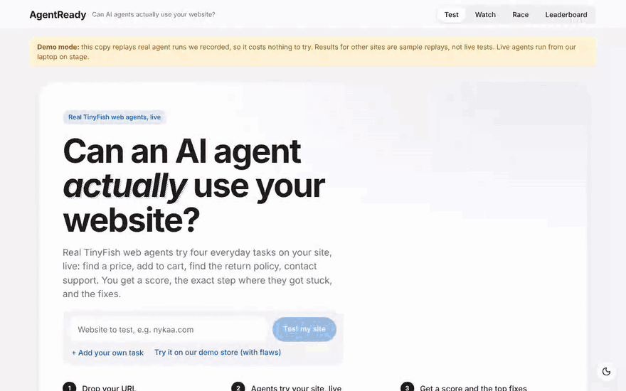

# AgentReady

**Existing tools read the menu. We order the food.**

AgentReady tests whether AI agents can actually use your website. Real [TinyFish](https://docs.tinyfish.ai) web agents try everyday tasks on your site, and you get a score and the fixes.

- **Real tasks, not a checklist.** Agents try to find a price, add to cart, find the return policy and find support, in parallel, in real cloud browsers.
- **See exactly where it broke.** Every finding shows the step and screenshot where the agent got stuck, names a cause on the site (not "the agent got confused"), and says how to fix it.
- **Catch problems early and later.** Run it from your terminal, in a pull request, or on a schedule that alerts you when AI shoppers can no longer buy.



*The clip above is the dashboard in replay mode (recorded agent runs, so it costs nothing): a Nykaa test, then our demo store before and after its four flaws are fixed.*

Show your score in your own README (the CLI and the GitHub Action both write this SVG):


## Quick start

### Command line

```bash
export TINYFISH_API_KEY=your-key
npx @agentready/cli https://your-site.com --no-tunnel          # a public site
npx @agentready/cli http://localhost:3000                       # your laptop (needs cloudflared, opens a temporary tunnel)
```

> Package publishing in progress. Until then, run `node apps/cli/bin/agentready.js <url>` from a clone of this repository.

You need Node 20+ and a TinyFish API key. Agents are billed by TinyFish at about $0.016 per step. On our demo store a full four-task test cost roughly ₹27 to ₹49, so two tasks on a small site is roughly ₹15 to ₹25; large stores take more steps and cost more. Flags (`--tasks`, `--json`, `--min-score`, `--badge`) are in [`apps/cli/README.md`](apps/cli/README.md).

### GitHub Action

```yaml
- uses: Manideep-2007-ok/Agent-Ready@v1
  with:
    url: https://your-preview.example.com     # must be public; cloud agents cannot reach localhost
    tinyfish-api-key: ${{ secrets.TINYFISH_API_KEY }}
    tasks: find_price,add_to_cart             # default; each agent step costs real money
    min-score: 80                             # fail the job below this score (0 = report only)
```

It posts one pull request comment (edited on every run), writes a job summary and uploads the report and badge. Setup and publishing steps: [`docs/PUBLISHING.md`](docs/PUBLISHING.md).

### Dashboard

```bash
npm install
npm run build -w @agentready/web && npm start     # open http://localhost:4000
```

Without a key it runs in **replay mode**: it replays agent runs we recorded on 31 Oct and 1 Nov 2026, so results for most sites are samples, not live tests. Put `TINYFISH_API_KEY` in `.env` (and drop `TINYFISH_MOCK=1`) for live tests. `bash scripts/setup-demo.sh` does all of this and asks for the key.

**Live demo (replay mode):** https://agentready-xajv.onrender.com — recorded runs, no live agents, so it is free to click around.

## What it checks

| Part | What it does |
|---|---|
| **4 tasks** | Find a product and its price, add it to the cart, find the return policy, find customer support. |
| **Score out of 100** | 25 points per task: passing, few steps, quick, no web-search detour. Plain code, same result every time. |
| **Bot-wall detection** | If a site turns agents away, we retry from an Indian home address, then in stealth mode, and tell you which one got in. Myntra blocked our cloud agent and let it in through an Indian proxy. |
| **Instant Scan** | In about 30 s: pop-ups covering the page, unlabelled buttons, prices drawn as images, missing product data. |
| **Watch** | Re-tests your live site on a schedule and posts a Discord/Slack alert when agents can no longer do a task (confirmed by a second run first). |
| **Race** | Same task on up to three sites; fewest steps wins. |
| **Leaderboard** | Ranked saved reports from the sites we tested. |

What we measured (details and screenshots in [`docs/RESEARCH.md`](docs/RESEARCH.md)): our demo store scored 91 with four flaws on and 97 with them fixed, and agents needed 35 steps instead of 19. In a 31 Oct test, Myntra blocked a no-proxy cloud agent. Agents can be wrong, so we only trust claims backed by steps and re-run on disagreement.

## Docs

- [`docs/ARCHITECTURE.md`](docs/ARCHITECTURE.md): what is built and how data flows
- [`docs/DECISIONS.md`](docs/DECISIONS.md): why each choice was made
- [`docs/RESEARCH.md`](docs/RESEARCH.md): every TinyFish fact and test result we measured
- [`docs/BACKEND-GUIDE.md`](docs/BACKEND-GUIDE.md): server and engine guide
- [`docs/PUBLISHING.md`](docs/PUBLISHING.md): npm package and GitHub Action
- [`AGENTS.md`](AGENTS.md): rules for coding agents

## Credits

Built at **Swim with TinyFish** (Scaler School of Technology, Bangalore, 1 Nov 2026) by Team Mavericks: Manideep Thumu, Sai Shakti Nayak and Akhil Daitha. Powered by [TinyFish](https://tinyfish.ai) web agents.

License: not yet chosen.
